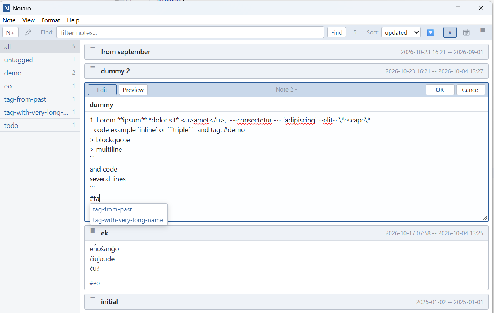
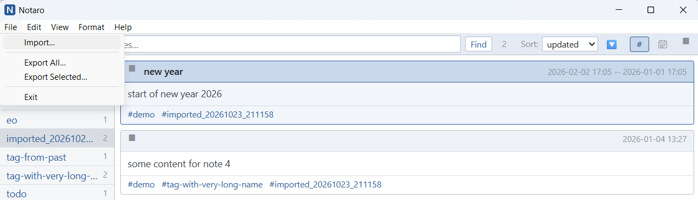
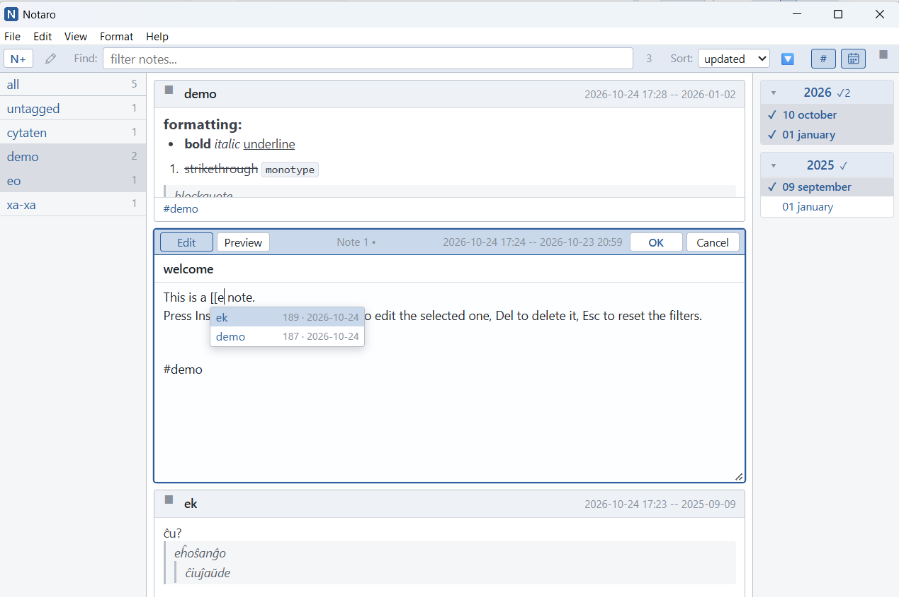
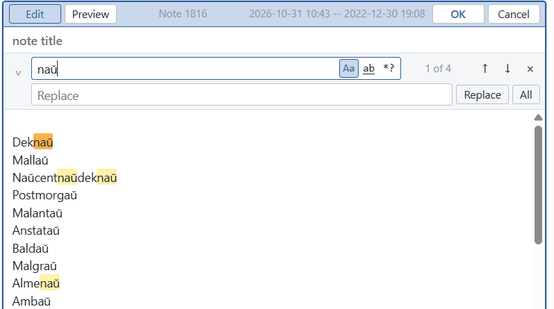
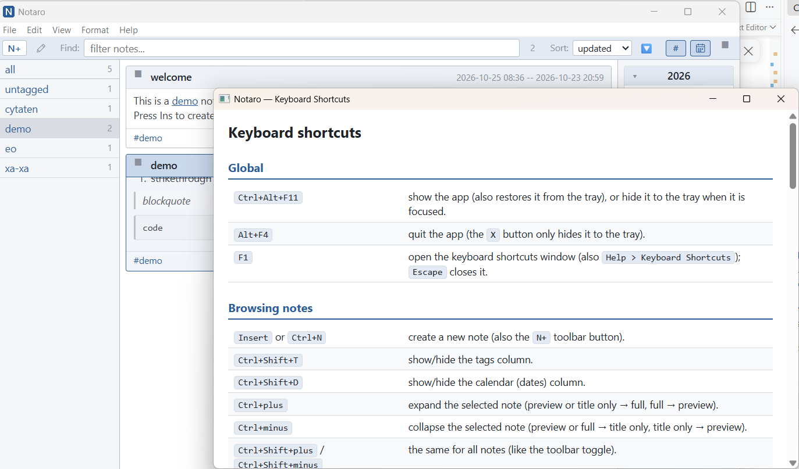
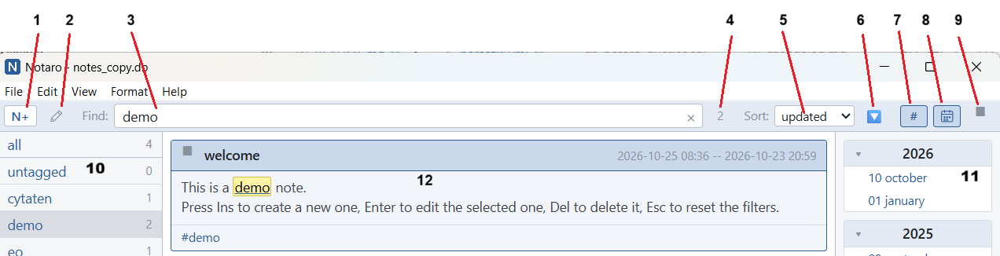

## Notaro

Notaro = "aro de notoj", set of notes, simple note-keeping app.
Written in tinyjs (https://tinyjs.app/docs.html), this implementation is in React.js. 
Database is SQLite, in file `notes.db` located in root of the app (auto-created on first run). 
Notes support Markdown formatting.

## Features

### Notes

- Each note has a title and a Markdown body (see [Markdown syntax](#markdown-syntax)), plus created and updated dates.
- Create a note with the `N+` toolbar button, `Insert` or `Ctrl+N`; `Ctrl+V` in the notes list creates a note from the clipboard text.
- Each card has a size toggle left of its title: `█` full note, `▀` 5-line preview (default), `▔` title only. A click cycles forward, `Shift+click` backward.
  The same toggle at the right end of the toolbar applies one mode to all notes (the top 20 at once, the rest a moment later); per-note changes made afterwards win until the next press. Sizes are kept in memory only.
- Select several notes with `Ctrl+click`, `Ctrl+Shift`+arrow keys or `Ctrl+A`; the toolbar then shows `N of M`. Copy, delete and export act on all selected notes.
- The `Edit` menu (`New Note`, `Copy Note`, `Paste as Note`, `Select All`, `Delete Note`) and a right-click menu on the notes offer the same commands; labels follow the selection (e.g. `Copy 3 Notes`).
- Delete removes the selected note(s) after one confirmation.

### Editing

- Notes are edited in place: the card turns into an editor with an Edit/Preview toolbar, `OK` and `Cancel`, then the title and the body (drag the body's bottom-right corner to resize it).
- One note is edited at a time. The pencil button next to `N+` edits the selected note, or scrolls back to the note being edited.
- Unsaved edits are protected: actions that change which notes are shown or edited (filters, new note, paste, editing another note, delete) close the editor, asking `Discard unsaved changes?` first. View toggles, sorting, copying, and clicks or text selection in other notes keep it open.
- Formatting shortcuts and the `Format` menu insert Markdown markers; lists continue on `Enter` and indent with `Tab` / `Shift+Tab`; `Ctrl+Z` undoes every change.
- Find and replace inside the note: `Ctrl+F` (`Edit > Find…`) opens a panel above the body, `Ctrl+R` (`Edit > Replace…`) adds the replace field.
  - Options: `Aa` match case, `ab` whole word, `*?` wildcards (`*` any text within a line, `?` one character; `\*`, `\?` for the characters themselves).
  - All matches are highlighted, the current one in orange, with `N of M` next to the field; `↑`/`↓` go to the previous/next match.
  - `Replace` and `All` replace the current or every match; one `Ctrl+Z` undoes each.

### Tags

- Tags are written in the body as `#word`: letters of any script, digits, `_`, `-`, `.` (e.g. `#tag1`, `#ĉu_aŭ`, `#1-2.3`), not inside code or links.
- While typing, `#` and a letter show a popup with matching existing tags.
- Tags are collected from the body when the note is saved with `OK`. They are shown in blue; clicking one in a note selects it in the tags column.
- A note shown as preview or in full (and the editor's Preview) ends with a row of its tags (`#todo #demo`); a last body line holding only tags is hidden there, but stays in the editor.
- Notes from older versions keep their tags: opening one for editing appends the missing tags as a last `#a #b` line.

### Links between notes

- Typing `[[` and a character in the editor shows a popup of notes (title, id and last-change date, the most recently changed first), filtered by the typed text: title start first, then title containing it, or the note id.
- Picking one inserts a Markdown link `[Note title](#note-234)`; its text can be edited freely, the id keeps it pointing at that note.
- Links are shown underlined; clicking one selects that note (clearing the filters if they hide it); a link to a deleted note says so.
- External links open in the default browser.
- Note ids change on import, so links between imported notes don't survive an export/import round trip.

### Finding and sorting

- The toolbar's Find field (`Ctrl+F` when no note is edited) shows only the notes that contain any of the entered words.
- The tags column (left) filters by tag; `Ctrl+click` picks several tags (notes with any of them). `all`, pinned at the top, clears the tag filter. A selected tag that no note has any more leaves the filter; with none left, `all` is selected again.
- The calendar column (right) lists the months with notes, grouped by year; years start collapsed and a click on the header shows or hides its months. Click a month to show its notes, `Ctrl+click` to pick several. Selected months are marked `✓`, a year header shows how many of its months are selected (`✓2`), and a collapsed year holding the selected month is highlighted in blue.
- Tag, date and Find filters combine; `Escape` in the notes list resets them.
- Sort by updated date, created date or title, 🔽 descending / 🔼 ascending.
- Both side columns can be hidden: toggle buttons at the right end of the toolbar, the `View` menu, or `Ctrl+Shift+T` / `Ctrl+Shift+D`; the state is remembered.

### Database, import and export

- Notes are stored in an SQLite file, `notes.db` by default; the window title shows its name (`Notaro - notes.db`).
- `File > Open Database…` switches to another database file, `Save Database As…` saves a copy of the current one, and `Reload` re-reads the notes from it (open and reload ask about unsaved edits first).
- `File > Import…` adds notes from an XML file.
- `File > Export All…` saves the listed notes.
- `File > Export Selected…` saves the selected ones (see [Export and import](./docs/export_import.md), including the XML file format).
- `File > Exit` quits, asking about unsaved edits first.

### Window and system

- Minimizing or closing the window with the `X` button hides it to the tray (icon with the letter N); `Alt+F4` quits.
- Left click on the tray icon shows/hides the window; right click opens a menu with `Show / Hide` and `Quit`.
- The global shortcut `Ctrl+Alt+F11` shows or hides the app from anywhere.
- The app icon (thin N, `assets/icon.png`) appears in the title bar and taskbar, and is embedded into the exe by `tinyjs build`.

### Help

- `Help > Keyboard Shortcuts` (or `F1`) opens a separate window with all shortcuts, from [keyboard_shortcuts.md](./docs/keyboard_shortcuts.md).
- `Help > Markdown Syntax` opens a separate window with [markdown_syntax.md](./docs/markdown_syntax.md): every supported marker in three columns — what to type, how it looks (rendered as notes show it), and the shortcut that inserts it.
- `Help > About Notaro` shows the current version and release date (from the top section of `changelog.md`).

## Screenshots

Main screen:

Edit note and insert tag:

Filtering by tag and text:

Import:

Multi-select tags and monthes, Insert link:

Find & Replace:

About popup:

Keyboard shortcuts window:

Toolbar:

1. New note button (`Ctrl+N` or `Ins`).
2. Edit button: edits the selected note (`Enter` or `F2`).
3. Filter field: shows only notes that contain any of the entered words (`Ctrl+F`).
4. Note counter: the number of listed notes, or "selected of listed" when several notes are selected.
5. Sort drop-down: by updated date, created date, or note title.
6. Sort order button: 🔼 ascending, 🔽 descending.
7. Toggle button to show or hide the tags panel on the left (`Ctrl+Shift+T`).
8. Toggle button to show or hide the calendar panel on the right (`Ctrl+Shift+D`).
9. Note size toggle for all notes, with three states: `▔` title only, `▀` preview (5 lines), `█` full note.
10. Tags panel: click a tag to show the notes with that tag; `Ctrl+Click` selects several tags. The top item, "all", clears the tag filter.
11. Calendar panel: lists the months in which notes were created, grouped by year. Click a month to show only that month's notes; `Ctrl+Click` selects several months.
12. Notes area: each note card has a clickable size toggle `▀`, a title, the "updated — created" dates at the top, and its tags at the bottom.

## Mass actions (not exposed in the UI)

A generic "mass action" tool exists in code but is **not wired into any menu**, so it isn't
reachable from the app today; it's kept for future reuse. It iterates every note, calls a
pure processing function `(note) => partialUpdate | null` on each one (`null` skips the
note), and writes back only the notes that changed, each keeping its own `updated_at`
(preserved unless the function changes it — a mass edit shouldn't look like the user edited
the note). Before writing, it backs up `notes.db` to `notes.db.bak-<timestamp>`, since there
is no undo.

Three built-in actions ship with the harness:

- **Remove Tag**: deletes `#tag` from every note that has it (in the body or, for notes
  saved before tags lived in the body, the database's tags column).
- **Replace Tag**: renames `#oldTag` to `#newTag` the same way.
- **Clear Updated-at Drift**: resets `updated_at` back to `created_at` on notes where
  ordinary edits made them diverge.

See `src/massActions.ts` (the harness and built-ins), `src/noteTags.ts#replaceTagInBody`
(the body rewrite), the backend's `bulkUpdateNotes` API in `backend/main.ts` (persistence
and backup), and the `AGENTS.md` "Mass actions" notes for how to re-enable a `Tools` menu
that calls them.

## Keyboard shortcuts

- `Ctrl+Alt+F11`: show the app from anywhere, or hide it to the tray.
- `Insert` or `Ctrl+N`: create a new note.
- `Enter` or `F2`: edit the selected note; `Ctrl+Enter` saves it, `Escape` cancels.
- `Ctrl+F`: filter the notes list, or find (`Ctrl+R`: and replace) in the note being edited.
- `F1`: the full list of shortcuts (also `Help > Keyboard Shortcuts`).

See the full list of global, browsing, editing and formatting shortcuts in
[keyboard_shortcuts.md](./docs/keyboard_shortcuts.md).

## Markdown syntax

Note text is Markdown. See all supported markers, how they look, and their keyboard shortcuts in
[markdown_syntax.md](./docs/markdown_syntax.md) (also `Help > Markdown Syntax`).

## How to run

### install tinyjs

mac/linux:
> curl -fsSL https://tinyjs.app/install | sh

windows:
> irm https://tinyjs.app/install.ps1 | iex

verify (in new terminal): 
> tinyjs version

### install dependencies
> npm install

### run dev build with hot reload
> tinyjs dev 

### create executable in `.dist` folder
> tinyjs build

## Versioning

`changelog.md` is the single source of truth for the version and release date: its top
`## version X.Y.Z, YYYY-MM-DD` entry is shown in `Help > About Notaro`.
The `"version"` in `tinyjs.json` (used by `tinyjs build`) must match it;
`npm run build` (and therefore `tinyjs build`) fails when they differ.
Check manually with
> npm run check-version

To release, ask the `Update Changelog` agent (`.github/agents/update-changelog.agent.md`),
e.g. "update changelog, minor": it adds a new section with the bumped version and today's date
and updates `tinyjs.json`.

## TODO

- implement soft delete (changes in db) and "show deleted", "clear deleted".
- show stats page (popup) with list of tags and count of notes in each, and list of calendar (years/monthes) with count of notes in each;
- implement history feature (list of visited notes with navigation back/forward as in browser). 
- create save/load filter (or "view") - the combination of tags/months/filter text to be able to remember current view and to reapply it later
- persist settings in DB (new table `settings`).

