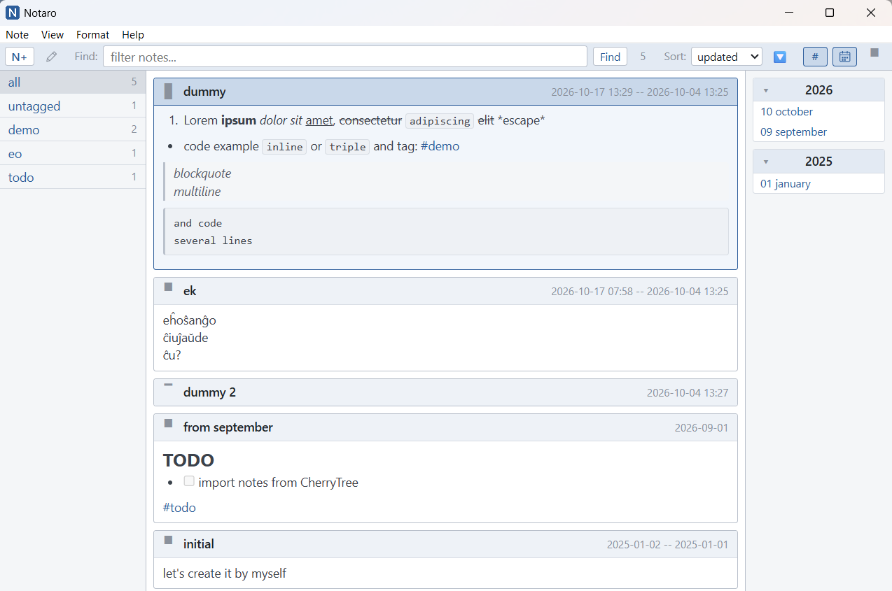
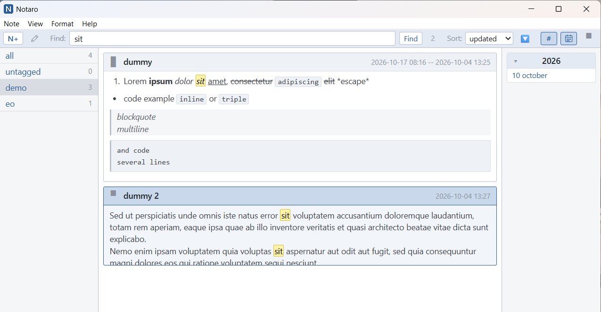
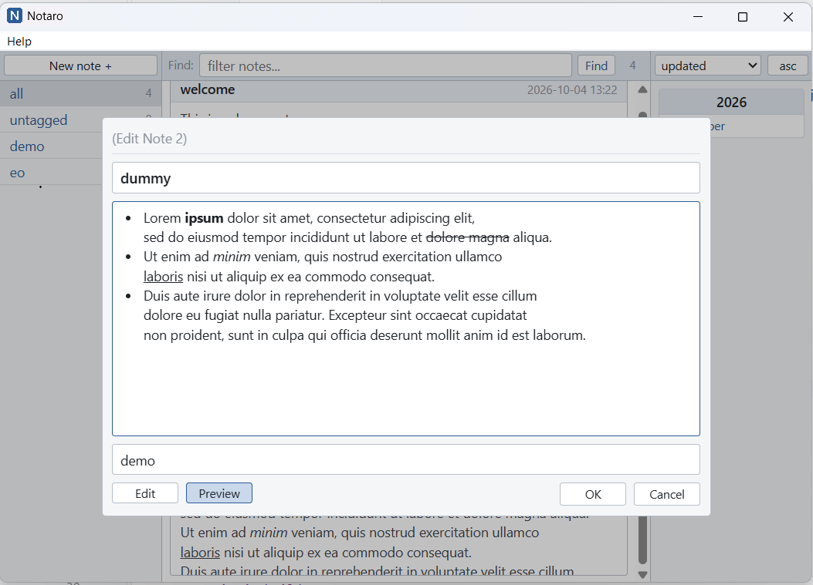
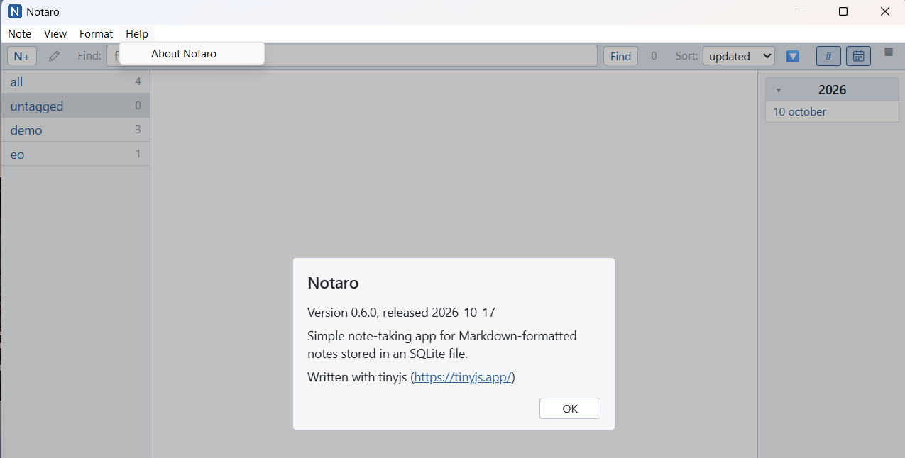

## Notaro

Notare = "aro de notoj", set of notes, simple note-keeping app.
Written in tinyjs (https://tinyjs.app/docs.html), this implementation is in React.js. 
Database is SQLite, in file `notes.db` located in root of the app (auto-created on first run). 
Notes support Markdown formatting.


Currently implemented:
 - create note;
 - edit note;
 - delete note;
 - filtering by tag, date and text;
 - sorting by updated/created date or title, 🔽 descending / 🔼 ascending;
 - collapsible tags and calendar columns: toggle buttons `#` and calendar icon at the right end of the
   toolbar (pressed = column shown), `View` menu, `Ctrl+Shift+T` / `Ctrl+Shift+D`; the state is remembered;
 - calendar years are collapsed on start; click a year header to show or hide its months
   (a collapsed year containing the selected month has its header highlighted in blue);
 - per-note height toggle left of the title: `█` full note, `▀` 5-line preview (default), `▔` title only;
   click cycles forward, Shift+click backward; kept in memory only (reset on restart, not saved to the DB);
 - the same toggle at the right end of the toolbar applies a mode to all notes (the top 20 at once,
   the rest a moment later); per-note changes made afterwards don't change it, and the next press
   overrides them again;
 - tray icon (letter N): minimizing or closing the window with the `X` button hides it to the tray,
   `Alt+F4` quits the app; left click on the icon shows/hides it, right click opens a menu with `Show / Hide` and `Quit`;
 - global shortcut `Ctrl+Alt+F11` shows/hides the app from anywhere;
 - app icon (thin N, `assets/icon.png`) in the window title bar and taskbar, embedded into the exe by `tinyjs build`;
 - `Help > About Notaro` popup showing the current version and release date (taken from the top section of `changelog.md`, `## version X.Y.Z, YYYY-MM-DD`).

## Screenshots

Main screen:


Filtering:


Edit popup:


About popup:



## Keyboard shortcuts

### Global

- `Ctrl+Alt+F11`: show the app (also restores it from the tray), or hide it to the tray when it is focused.
- `Alt+F4`: quit the app (the `X` button only hides it to the tray).

### Browsing notes

- `Insert` or `Ctrl+N`: create a new note (also the `N+` toolbar button).
- `Ctrl+Shift+T`: show/hide the tags column.
- `Ctrl+Shift+D`: show/hide the calendar (dates) column.
- `Ctrl+plus`: expand the selected note (preview or title only → full, full → preview).
- `Ctrl+minus`: collapse the selected note (preview or full → title only, title only → preview).
- `Ctrl+Shift+plus` / `Ctrl+Shift+minus`: the same for all notes (like the toolbar toggle).
- `Ctrl+V`: open a new note titled `clipboard` with the clipboard text as its body.
  Review it, then save with `OK`.
- `Ctrl+C`: copy the selected note (title, blank line, body). With text selected in a note,
  `Ctrl+C` copies just that text.
- `Enter` or `F2`: edit the selected note (or double-click the note's header bar).
- `Delete`: delete the selected note.
- `Escape`: reset filters when the dialog is closed.
- `Ctrl+F`: focus and select the Find field.
- Right-click a note or the empty list: menu with the commands above and their shortcuts
  (`ArrowUp`/`ArrowDown`, `Enter`, `Escape`); `Copy Selection` is added when text in the note is selected.
- Note text can be selected with the mouse (drag, double-click a word).
- `Shift`+right-click: the browser's own menu, for `Inspect` (DevTools are available in `tinyjs dev`; `F12` opens them too).

### Editing a note

- `Escape`: cancel the note dialog.
- `Ctrl+Enter`: save the note from the dialog.
- `ArrowDown` in the title field: move to the start of the body.
- `ArrowUp` in the tags field: move to the end of the body.
- `ArrowUp` at the top of the body: move to the end of the title.
- `ArrowDown` at the bottom of the body: move to the start of the tags.
- `Ctrl+ArrowUp` in the body: move to the end of the title.
- `Ctrl+ArrowDown` in the body: move to the start of the tags.
- `Tab` in the body: on a list item, nest it one level deeper (four spaces), taking its
  sub-items along and the marker style of the items already on that level; elsewhere
  insert a tab, or indent selected lines.
- `Shift+Tab` in the body: move a list item one level up (restyled to match that level),
  or outdent selected lines.
- `Ctrl+Tab` in the body: toggle Edit/Preview mode.
- `Enter` in a list item (`-`, `*`, `+`, `1.`, `1)` or `>`): start the next item
  (numbers count up). `Enter` on an empty nested item moves it one level up; on an empty
  top-level item it ends the list. `Shift+Enter` inserts a plain line break.
- Numbered lists renumber themselves when an item is added, removed or moved; only the
  list being edited changes, and it keeps its starting number. `Ctrl+Z` undoes the
  renumbering first, then the edit.

### Formatting the note body

The same commands are in the `Format` menu.
Inline styles wrap the selection; pressing the shortcut again removes the style.
With no selection they insert an empty pair of markers and put the cursor between them.
Line styles apply to every line touched by the selection; pressing again removes them.
`Ctrl+Z` undoes each step.

- `Ctrl+B`: bold, `**text**`.
- `Ctrl+I`: italic, `*text*`.
- `Ctrl+U`: underline, `<u>text</u>`.
- `Ctrl+K`: strikethrough, `~~text~~`.
- `Ctrl+M`: monospace, `` `text` `` (a fenced code block when the selection spans several lines).
- `Ctrl+1`, `Ctrl+2`, `Ctrl+3`: heading level 1, 2, 3.
- `Ctrl+9`: numbered list.
- `Ctrl+0`: bulleted list.
- `Ctrl+D`: clear all formatting from the selected lines.


## How to run

install dependencies
> npm install

run dev build with hot reload
> tinyjs dev 

create executable in `.dist` folder
> tinyjs build

## Versioning

`changelog.md` is the single source of truth for the version and release date: its top
`## version X.Y.Z, YYYY-MM-DD` entry is shown in `Help > About Notaro`.
The `"version"` in `tinyjs.json` (used by `tinyjs build`) must match it;
`npm run build` (and therefore `tinyjs build`) fails when they differ.
Check manually with
> npm run check-version

To release, ask the `Update Changelog` agent (`.github/agents/update-changelog.agent.md`),
e.g. "update changelog, minor": it adds a new section with the bumped version and today's date
and updates `tinyjs.json`.


# h1 example of formatting

1. Lorem **ipsum** *dolor sit* <u>amet</u>, ~~consectetur~~ `adipiscing` ~elit~ \*escape\*
- code example `inline` or ```triple``` 
> blockquote
> multiline
```
and code
several lines
```

## TODO

- find (and replace) while edit notes - new popup


- rework of tags: 
  -- in edit popup - don't show separate input field for tags;
  -- tags will be - any single word from digits, letters (all: latin, cyrrilic, esperanto, chinese), minus, and underscores;
  -- list of tags is collected after note finished edit with OK and then sent to backend as it is done now;
  -- tags in preview and in main list are displayed with blue color as clickable item, on click it selects the related tag in left tags column.

- rework of edit popup:
  -- don't use popup, but implement editing in place: the selected note became editable block, the title is editable, and the body. the "toolbar" with buttons should go to the top of the editable block. format menu - the same (if possible).

- add Settings menu
- add View menu
- add Actions menu
- implement soft delete (changes in db) and "show deleted", "clear deleted"